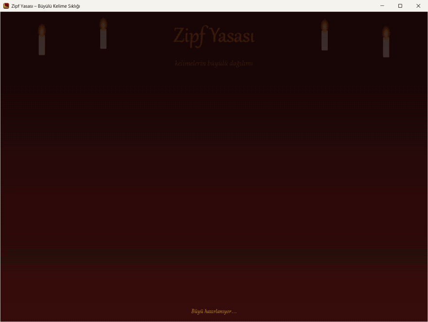
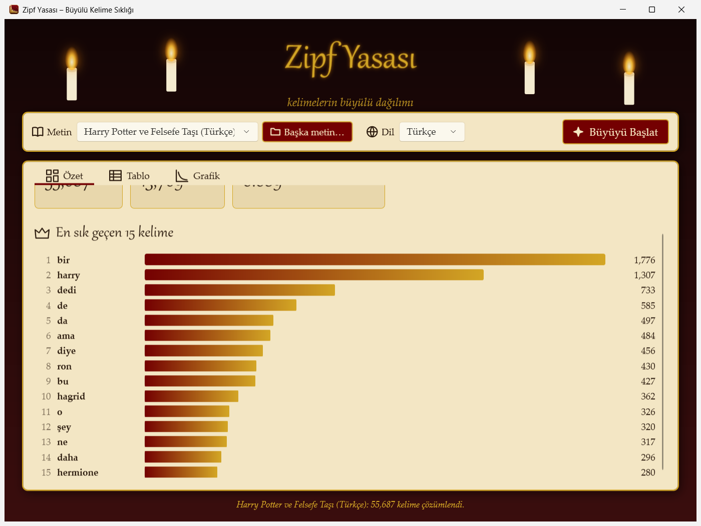
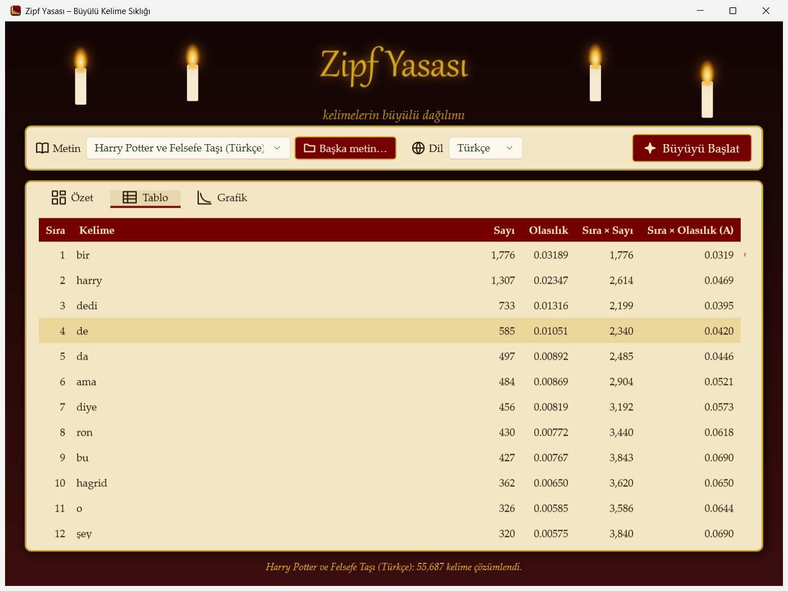
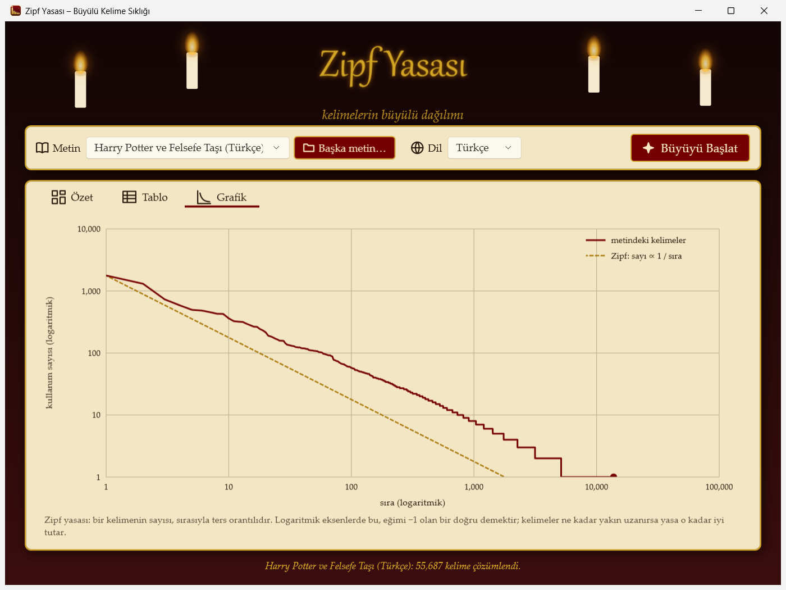
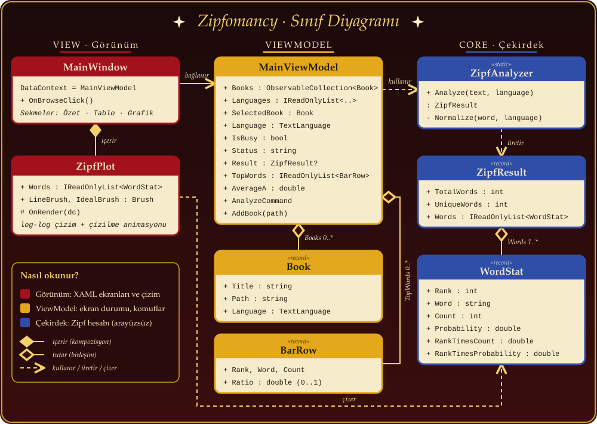
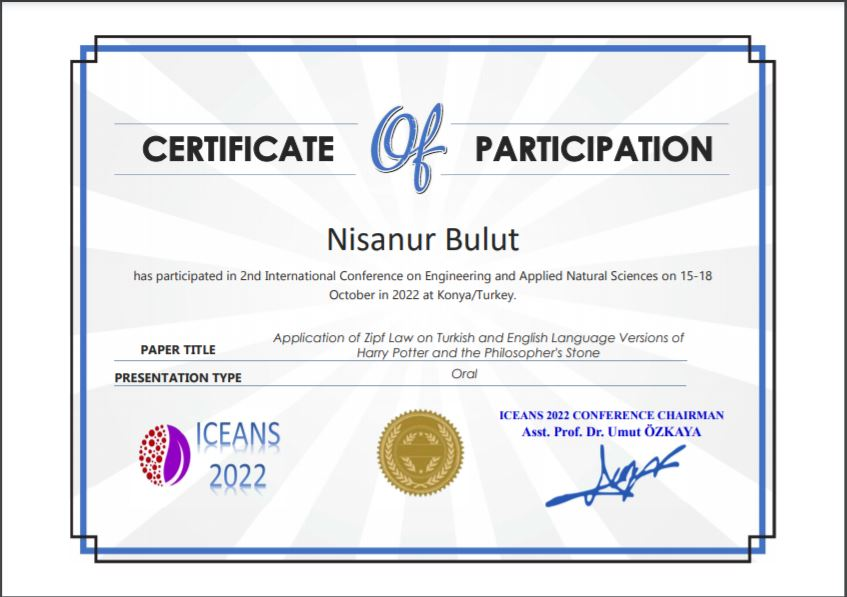

<p align="center">
  
</p>

<p align="center">🇬🇧 English · 🇹🇷 <a href="docs/README.tr.md">Türkçe</a></p>

<p align="center">
  <b>🪄 A WPF app that finds magic in the words of a book.</b><br>
  Explore <b>Zipf's law</b> in Harry Potter, in Turkish and in English. 🕯️
</p>

<p align="center">
  <a href="https://github.com/NisanurBulut/ZipfLaw_NLP/actions/workflows/dotnet.yml"></a>
  <a href="https://github.com/NisanurBulut/ZipfLaw_NLP/releases"></a>
  
  
  
  <a href="LICENSE"></a>
</p>

<p align="center">
  ⭐ <b>Do you like Zipfomancy? Please give it a star!</b> ⭐<br>
  It is free and it only takes a second, but it helps me a lot.<br><br>
  <a href="https://github.com/NisanurBulut/ZipfLaw_NLP"></a>
</p>

<p align="center">
  
</p>

Zipfomancy reads a book, counts every word and puts the words in order, from the most common to the least common.
Then it shows you if **Zipf's law** is true for this text.

You see the result on three screens: **Summary**, **Table** and **Chart**.
The app looks like a Harry Potter common room: red and gold colors, floating candles, a glowing title, bars that grow and a chart that draws itself.

> [!NOTE]
> The texts in the app are in Turkish. The tabs are called *Özet* (Summary), *Tablo* (Table) and *Grafik* (Chart).

This is the new version (WPF / MVVM) of the app from my paper at [ICEANS 2022](#-publication).
The first WinForms version is still in this repository.

## ✨ What can it do?

| | Feature |
|---|---|
| 📖 | **Two books are ready to use**: *Harry Potter and the Sorcerer's Stone* in Turkish and in English. With **Başka metin…** (Another text…) you can open any `.txt` file. |
| 🌍 | **Turkish and English**: the Turkish rules for the letters I and ı are correct, and a word like *Harry'nin* is counted as *harry*. |
| 🔢 | **All the Zipf numbers**: total words, different words, rank, probability, `rank × count` and `A = rank × probability`. |
| 📊 | **Three screens**: Summary (bars that grow), Table (every word, rows you can select) and Chart (a log-log plot with the Zipf line). |
| 🕯️ | **A magic look**: floating candles, a glowing title, golden buttons and a curve that draws itself. It uses only XAML and drawing code, with no extra UI or chart package. |
| ⚡ | **Smooth**: the work runs in the background, so the window never freezes. |

## 🖼️ Screens

<table>
  <tr>
    <td align="center"><b>📋 Summary</b><br></td>
    <td align="center"><b>🗂️ Table</b><br></td>
    <td align="center"><b>📈 Chart</b><br></td>
  </tr>
</table>

## 🚀 Quick start

You need Windows and the [.NET 10 SDK](https://dotnet.microsoft.com/download).

```bash
dotnet run --project src/ZipfLaw.Wpf
dotnet test ZipfLaw.sln
```

1. The app opens and reads the first book by itself.
2. Choose a book in **Metin** (Text) and a language in **Dil** (Language). Or click **Başka metin…** to open your own file.
3. Click **Büyüyü Başlat** (Start the spell), then look at the three tabs.

## 🤔 What is Zipf's law?

1. Count how often each word is used in a text.
2. Put the words in order. The most common word gets **rank 1**, the next one gets rank 2, and so on.
3. Zipf's law says that **rank × count** is almost the same number for every word.
   So the number 1 word is used about twice as often as the number 2 word, and about three times as often as the number 3 word.

In numbers: `probability = count / N`, where `N` is the number of all words in the text. Then `rank × probability = A`, and `A` is often near 0.1.

The law works for many languages. It also works for other things, for example the sizes of cities.
Nobody knows exactly why. 🪄

## 📊 Results

Here are the numbers for the two books. Words are counted as they are (there is no word stemming for Turkish yet).
When the rank goes from 1 to 1000, `rank × count` stays in the same range, and `A` is close to **0.1** for the first 100 words.

| | 🇹🇷 Turkish | 🇬🇧 English |
|---|---|---|
| All words | 55,687 | 77,911 |
| Different words | 13,769 | 5,972 |
| Top 3 words | bir, harry, dedi | the, and, to |
| Rank 1 → `rank × count` | `bir` → 1,776 | `the` → 3,630 |
| Rank 10 → `rank × count` | `hagrid` → 3,620 | `in` → 9,680 |
| Rank 100 → `rank × count` | `üstüne` → 5,800 | `only` → 11,100 |
| Rank 1000 → `rank × count` | `sorun` → 8,000 | `narrow` → 10,000 |
| **A** (first 100 words) | **0.089** | **0.133** |

> [!NOTE]
> Zipf's law is not an exact rule. The numbers are never the same, but in the chart the words stay near the Zipf line.
> The old WinForms version divided by the number of different stems when it calculated `A`. Zipfomancy uses the formula above, with `N` = all words.

## 📐 Architecture

The code has three layers, and every class does one job. The core knows nothing about the window or about files, and the view model uses no WPF types.

<p align="center">
  
</p>

| Layer | Color | What does it do? |
|---|---|---|
| 🟥 **View** (`src/ZipfLaw.Wpf/Views`, `Controls`) | red | The XAML screens, the `ZipfPlot` chart and the candle animation. |
| 🟨 **ViewModel** (`src/ZipfLaw.Wpf/ViewModels`) | gold | The state of the screen and the `AnalyzeCommand` ([CommunityToolkit.Mvvm](https://learn.microsoft.com/dotnet/communitytoolkit/mvvm/)). It reads the file and calls the core. |
| 🟦 **Core** (`src/ZipfLaw.Core`) | blue | `ZipfAnalyzer.Analyze(text, language)`. No packages, no UI, easy to test. |

**Start the spell → `MainViewModel.AnalyzeAsync` → `ZipfAnalyzer.Analyze` → `ZipfResult` → Summary, Table, Chart.**

## 📜 Publication

I presented this work as an **oral presentation** at an international conference.

| | |
|---|---|
| **Title** | *Application of Zipf Law on Turkish and English Language Versions of Harry Potter and the Philosopher's Stone* |
| **Author** | Nisanur Bulut |
| **Conference** | 2nd International Conference on Engineering and Applied Natural Sciences (**ICEANS 2022**) |
| **Date and place** | 15–18 October 2022, Konya, Türkiye |
| **Type** | Oral presentation |
| **Documents** | 📄 [Paper (PDF)](NB_conference_paper.pdf) · 🏅 [Certificate (PDF)](Iceans_NisanurBulut_Certificate-037.pdf) · 📘 [Extra document (PDF)](<Harry Potter ve Felsefe Taşı Kitabının İngilizce ve.pdf>) |

<p align="center">
  
</p>

<details>
<summary>📎 How to cite (BibTeX)</summary>

```bibtex
@inproceedings{bulut2022zipf,
  author    = {Nisanur Bulut},
  title     = {Application of Zipf Law on Turkish and English Language Versions of Harry Potter and the Philosopher's Stone},
  booktitle = {2nd International Conference on Engineering and Applied Natural Sciences (ICEANS 2022)},
  address   = {Konya, T{\"u}rkiye},
  month     = {October},
  year      = {2022}
}
```

</details>

## 🏷️ Releases and versions

Work happens on branches. A branch reaches `master` with a **pull request** (a request to merge the branch).
When a pull request is merged, GitHub Actions makes a new **GitHub release** with a version number like `v1.2.3`.
The first version is `v0.0.0`. The name of the branch decides which number goes up:

| Branch name | Number that goes up | Example | Label on the pull request |
|---|---|---|---|
| `major_…` | **major** (the other two go back to 0) | `v0.0.0` → `v1.0.0` | 🔴 `breaking` |
| `dev_…` | **minor** (the patch goes back to 0) | `v1.0.0` → `v1.1.0` | 🟡 `enhancement` |
| `hotfix_…` and all other names | **patch** | `v1.1.0` → `v1.1.1` | 🟠 `bug` |

| Workflow | When does it run? | What does it do? |
|---|---|---|
| [`dotnet.yml`](.github/workflows/dotnet.yml) | A push to `master` and every pull request | Builds the app on Windows, runs the tests and puts a label on the pull request. |
| [`release.yml`](.github/workflows/release.yml) | A pull request is merged into `master` | Creates the next `vX.Y.Z` tag and the release notes. A direct push does not make a release. |
| [`auto-assign.yml`](.github/workflows/auto-assign.yml) | A pull request is opened or merged | Assigns the pull request to its author and to the person who merged it. |

All releases are on the [**Releases**](https://github.com/NisanurBulut/ZipfLaw_NLP/releases) page.

## 🗂️ Project structure

| Path | Content |
|---|---|
| `src/ZipfLaw.Core` | The Zipf calculation. A class library with no packages, no UI and no file reading. |
| `src/ZipfLaw.Wpf` | The WPF app: screens, view model, Harry Potter theme, icons, animations and the chart control. |
| `tests/ZipfLaw.Core.Tests` | xUnit tests (counting, order, Zipf numbers, Turkish letter rules). |
| `docs/images` | Logo, banner, UML diagram, screenshots and the animation for this README. |
| `docs/README.tr.md` | The Turkish README, with the full text about the first version. |
| `tools` | A script for the logo and icon (`render-assets.ps1`) and a script that records the animation (`record-demo-gif.cs`). |
| `ZipfLawNLP/` | The first WinForms version (.NET Framework, NZemberek, LiveCharts). It stays as it is, and CI does not build it. |

> [!TIP]
> The project is called **Zipfomancy**. The folder names, the namespaces (`ZipfLaw.*`) and the repository name have not changed yet.

<details>
<summary>🛠️ How to make the images again</summary>

```bash
powershell -STA -File tools/render-assets.ps1
dotnet build ZipfLaw.sln
dotnet run tools/record-demo-gif.cs
```

`render-assets.ps1` makes the logo PNG and the app icon (`src/ZipfLaw.Wpf/Assets/zipfomancy.ico`) from `tools/logo.xaml`.
`record-demo-gif.cs` opens the app, clicks through the tabs and saves the window as `docs/images/zipfomancy-demo.gif`.
After you change the screens, build first and then record the animation again.

</details>

## 🌍 Turkish documentation

The full Turkish text is in [docs/README.tr.md](docs/README.tr.md). It also explains the first WinForms version: Zemberek word stems and endings, the pie charts and the results of that version.

## 📄 License

GPL-3.0, see [LICENSE](LICENSE).

---

<p align="center">
  ⭐ <b>Made with words, candles and a little math. If you like it, please <a href="https://github.com/NisanurBulut/ZipfLaw_NLP">star the repository</a>!</b> ⭐
</p>
